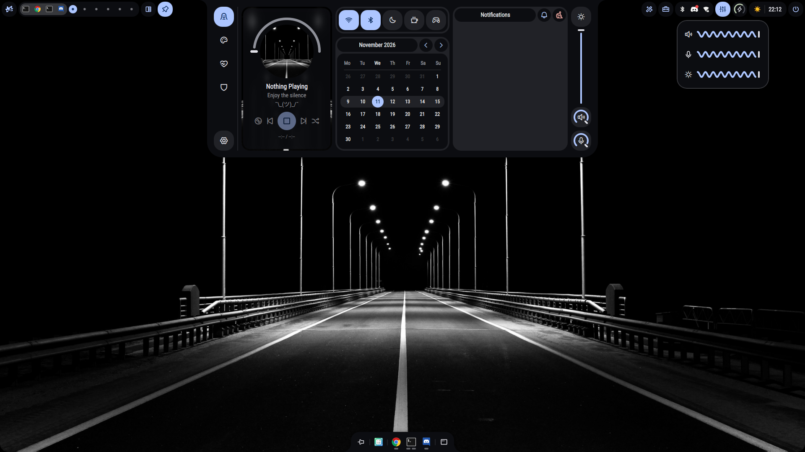
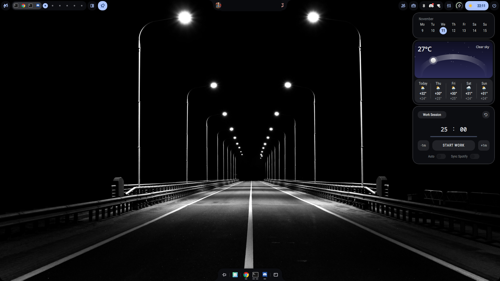
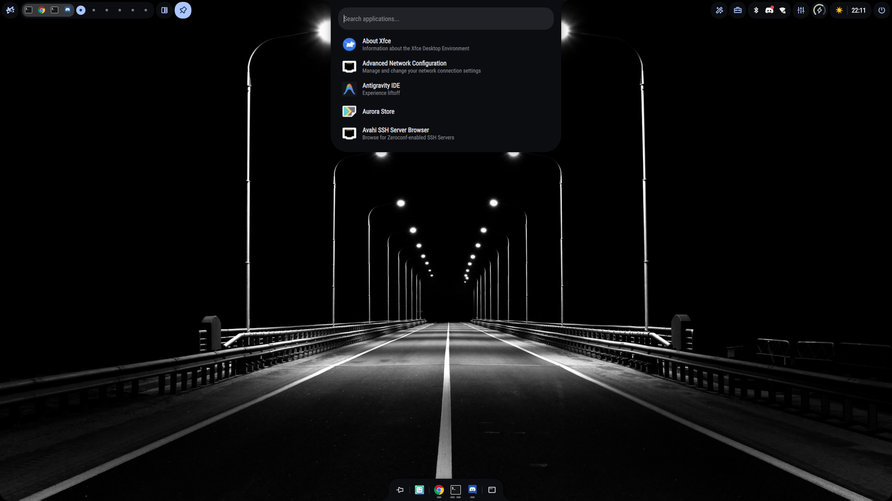

# Prodigal

Prodigal is a customizable Wayland desktop shell built with Quickshell and tailored for Hyprland. It combines a panel, dashboard, launcher, desktop widgets, notifications, and system controls.

This is a personal fork of [Ambxst by Axenide](https://github.com/Axenide/Ambxst). The inherited project license and asset attribution notices are included in this repository.

<p align="center">
  <a href="https://github.com/Prodi9al/hyprland/stargazers"></a>
  <a href="https://github.com/Prodi9al/hyprland/issues"></a>
  <a href="https://github.com/Prodi9al/hyprland/blob/main/LICENSE"></a>
</p>

## Features

- Configurable panel, dock, notch, workspace controls, and multi-monitor layouts
- App launcher, clipboard history, emoji picker, notes, and tmux session manager
- Dashboard with metrics, calendar, weather, media, notifications, and Hack The Box profile
- Lockscreen, desktop icons, overview, and power menu
- Theme and keybinding editors
- AI assistant, OCR, QR and barcode scanning, color picker, screenshots, and screen recording
- Audio, Bluetooth, network, brightness, power profile, night light, and game mode controls

## Screenshots

<p align="center">
  
</p>

<p align="center">
  
  
</p>

## Requirements

- Hyprland
- Arch Linux, Fedora, or NixOS for the automated installer
- Internet access during installation to download dependencies

Other distributions and Wayland compositors are not currently supported by the installer.

## Installation

Clone the repository and run the installer:

```bash
git clone https://github.com/Prodi9al/hyprland.git ~/.local/src/prodigal
cd ~/.local/src/prodigal
./install.sh
```

The installer installs dependencies and creates the `prodigal` command. It may ask for your password when system packages or files need administrator access. Do not run it as root.

Add Prodigal to Hyprland:

```bash
prodigal install hyprland
```

Start the shell with:

```bash
prodigal
```

The generated Hyprland source block loads Prodigal. Put personal overrides below that block to keep them separate from generated settings.

## Configuration

The main configuration is in `~/.config/prodigal`. Generated Hyprland files and shell state are stored under `~/.local/share/prodigal` and `~/.local/state/prodigal`.

Use the in-shell settings panel to change the layout, theme, widgets, and keybindings. Source defaults are in `config/defaults/`; bundled layouts and themes are in `assets/presets/`.

### Hack The Box profile

The dashboard can load a public profile without a token. For authenticated requests, create the ignored local file `scripts/htb_env.sh` and add:

```bash
export HTB_TOKEN="your-token"
```

Keep this file local. It is excluded from Git; never commit or share the token.

## NixOS

The flake exports a package and a NixOS module. The module option is `programs.prodigal`.

For screen recording through the system portal, enable `programs.gpu-screen-recorder` in your NixOS or Home Manager configuration.

## Support

Report bugs or request changes in [GitHub Issues](https://github.com/Prodi9al/hyprland/issues).

## Credits

Prodigal is based on Ambxst, created by Axenide, and uses Quickshell. See the included license and asset-specific notices for attribution and license terms.
